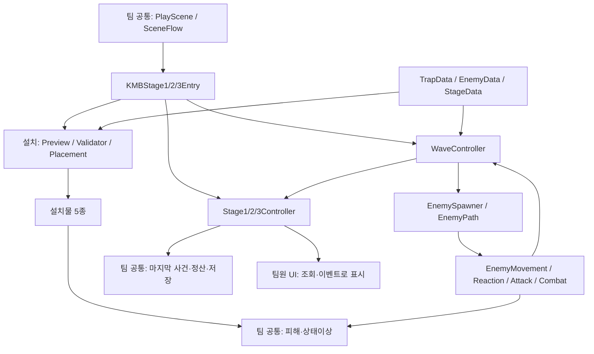

# 구조와 책임 분리

[README](../README.md) · [공통 의존성](DEPENDENCIES.md)

## 전체 연결

표시된 공통 시스템의 구현은 저장소에 포함하지 않습니다. 구조도는 실제 참조·흐름의 요약이며 클래스 상속도는 아닙니다.

## 정적 설정과 실행 상태

| 설정 데이터 | 실행 중 상태 |
| --- | --- |
| TrapData의 비용·점유 크기·상한 | 실제 점유 셀, 도전 내 설치 수, 실제 지불 비용 |
| EnemyData의 전투·이동·반격 설정 | 현재 경로·웨이포인트·반격 대상·생존 상태 |
| StageData의 웨이브·제한시간 | 현재 웨이브·생존 적·통과·전환·종료 대기 |

데이터 값만으로 모든 새 기능을 추가할 수 있는 구조는 아닙니다. 기존 규칙의 수치·콘텐츠를 교체하는 부분과 새 공격·판정 코드가 필요한 부분을 구분합니다.

## 작은 책임 경계

- [BuildArea](../src/Installation/BuildArea.cs)는 셀과 점유를 관리하고 재화를 지급하지 않습니다.
- [BuildPlacementValidator](../src/Installation/BuildPlacementValidator.cs)는 공간 조건을 검사합니다.
- [BuildPlacementController](../src/Installation/BuildPlacementController.cs)가 점유·소비·생성을 조율하고 실패를 복구합니다.
- [EnemyReaction](../src/Enemy/EnemyReaction.cs)은 반격 허용과 정지·재개를 결정하고, [EnemyMovement](../src/Enemy/EnemyMovement.cs)가 이동을 수행합니다.
- [WaveController](../src/Wave/WaveController.cs)는 스폰·생존·완료를 관리하고, [Stage3Controller](../src/Stage/Stage3Controller.cs)는 해당 스테이지의 전환·승패·별·점수를 판단합니다.

## 검토할 때 주의할 포함 관계

게임 결과를 계산하는 것과 실제 보상을 지급·저장하는 것은 다른 책임입니다. KMB는 확정 점수와 사건·결과를 제공하며, 공용 조율부가 저장·보상과 화면 전환을 처리합니다. UI도 전달받은 값과 상태를 표시하고 승패를 재판정하지 않습니다.
