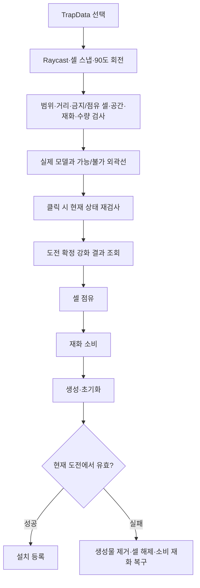

# 설치 검증·프리뷰·강화

[README](../README.md) · [설치 소스](../src/Installation/)

## 문제와 접근

프리뷰가 가능 상태일 때도 실제 클릭 전후에는 셀·재화·도전 상태가 바뀔 수 있습니다. 시각 표시를 최종 승인으로 쓰지 않고 설치 직전에 다시 검사했습니다.

## 좌표와 공간 검사

[BuildArea](../src/Installation/BuildArea.cs)는 월드 위치를 로컬 좌표로 변환해 셀을 구합니다. 회전된 영역에서도 해당 영역을 기준으로 스냅합니다. 설치물의 전체 점유 범위와 금지·점유 셀을 확인하고, 인접 설치에서 경계가 닿기만 하는 것은 허용하도록 작은 검사 여유를 둡니다.

[BuildPlacementValidator](../src/Installation/BuildPlacementValidator.cs)는 OverlapBox로 캐릭터와 지정 장애물을 확인합니다. 단순히 바닥 격자가 보이는 것만으로 설치를 허용하지 않습니다.

## 비용과 점유의 복구

[BuildPlacementController.TryPlaceInstallation](../src/Installation/BuildPlacementController.cs)의 `try/finally`를 먼저 읽으면 실패 처리를 확인할 수 있습니다.

- 강화 조회 실패는 점유·소비 전에 중단합니다.
- 생성·초기화 실패 시 생성된 객체를 비활성화한 후 제거합니다.
- 실제로 점유한 범위만 해제합니다.
- 실제로 비용을 소비한 경우에만 원래 도전에 복구합니다.
- 도전이 바뀌었으면 새 도전에 환불하지 않고 실패를 기록합니다.

## 모델 프리뷰

[InstallationModelPreview](../src/Installation/InstallationModelPreview.cs)는 프리팹의 지정 시각 루트에서 메시·머티리얼을 복사합니다. 공격 스크립트와 Collider를 통째로 복제하지 않습니다. 스킨 메시인 장전 화살 등은 정적 메시로 베이크합니다.

Linework 사용 시 유효·불가 Rendering Layer를 전환합니다. [InstallationPreviewOutline.shader](../src/Shaders/InstallationPreviewOutline.shader)는 별도의 대체 외곽선 경로이며 Linework 패키지 자체의 소스가 아닙니다.

새 모델이 시각 루트와 필수 구조를 유지하면 프리뷰에도 반영됩니다. 발사점·터렛 축·Animator·파티클 구조가 다르면 해당 참조 연결이 필요합니다.

## 설치물 5종

| 설치물 | 담당 동작 |
| --- | --- |
| [SpikeTrap](../src/Installation/SpikeTrap.cs) | 범위 감지와 주기 피해 |
| [ArrowTower](../src/Installation/ArrowTower.cs) | 적 탐색·회전·장전·발사와 투사체 실행 연결 |
| [FrostTrap](../src/Installation/FrostTrap.cs) | 감속 갱신과 강화 감속 수치 적용 |
| [ShockTrap](../src/Installation/ShockTrap.cs) | 범위 피해·기절 요청 |
| [FireTrap](../src/Installation/FireTrap.cs) | 체류 시간 피해·화상 요청·작동음 연결 |

한 적의 여러 Collider는 EnemyCombat 기준으로 중복 제거합니다. 피해·상태이상의 공통 계산은 팀 모듈에 요청합니다.

## 강화와 수량 제한

로비 강화 결과는 PlayScene의 도전별 조회 API로 받아 설치물에 적용합니다. 강화 상점과 계산 기반 자체는 LJ 담당입니다.

[PlacedInstallation](../src/Installation/PlacedInstallation.cs)은 `TrapId`, 재화 컨텍스트, 도전 번호로 설치 수를 관리합니다. 상한 0은 무제한입니다. 철거 시에는 저장한 점유 범위와 실제 지불 비용을 기준으로 처리합니다.

## 남은 확인

프리뷰·실제 설치·철거·수량 제한을 함께 재현하고, 다수 포탑·파티클의 성능은 별도 측정해야 합니다. 원본 프로젝트와 에셋이 제외돼 이 저장소에서 실행할 수는 없습니다.
