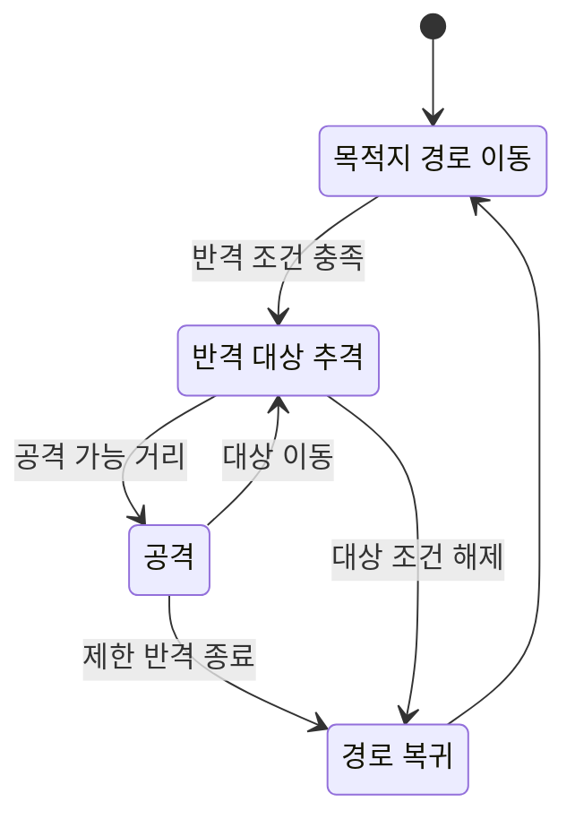

# 적 이동·반격·상태이상

[README](../README.md) · [적 소스](../src/Enemy/)

## 목적지 우선 이동

기본형·빠른 적·탱커·비행형을 구성했습니다. 지상 적은 NavMesh로, 비행 적은 비행 높이를 반영한 웨이포인트로 이동합니다. 비행 적의 방어 목표 접근은 실제 공격 가능한 높이로 조정합니다.

기절·넉백·사망 등은 위 흐름에 영향을 주는 공통 중단 조건입니다. 이 그림은 대표 흐름이며 전체 코드의 모든 상태를 열거한 FSM 구현도는 아닙니다.

## 코드별 역할

- [EnemySpawner](../src/Enemy/EnemySpawner.cs): 생성·이동 경로·목표·전투 배율 전달.
- [EnemyMovement](../src/Enemy/EnemyMovement.cs): 웨이포인트 이동, 추격·복귀와 출구 전환.
- [EnemyReaction](../src/Enemy/EnemyReaction.cs): 반격 대상과 허용 상태, 이동 중단·재개.
- [EnemyAttack](../src/Enemy/EnemyAttack.cs): 공격 가능 여부와 타격, 방어 목표 공격.
- [EnemyCombat](../src/Enemy/EnemyCombat.cs): 피해·상태이상·사망의 공통 모듈 연결.
- [EnemyAnimation](../src/Enemy/EnemyAnimation/EnemyAnimation.cs): 이동·공격·피격·사망의 Animator 연결.

## 반격 정책

[EnemyReactionMode](../src/Enemy/EnemyReactionMode.cs)는 제한 반격·지속 반격·플레이어 반격 무시를 구분합니다. 제한 반격은 정해진 공격 기회 뒤 경로로 복귀하고, 지속 반격은 대상 조건을 계속 검사합니다.

피해를 준 동료도 생존·거리·접근 가능 여부를 확인해 반격 후보에 포함합니다. 방어 목표에 도착한 일반 적은 목표 공격을 우선하며, 보스는 별도의 플레이어 지속 추격 모드를 사용합니다.

## 상태이상과 생명주기

공용 StatusEffectController·KnockbackController의 상태에 따라 속도와 행동을 반영합니다. 상태가 끝나면 추격 또는 경로 이동을 재개합니다. 기절 면역의 적도 별도 피해를 받을 수 있도록 피해 처리와 기절 적용 결과를 구분합니다.

사망과 출구 통과는 다른 사건입니다. 적이 통과했다는 이유로 처치 보상이 지급되지 않도록 WaveController에 별도로 전달합니다. 사망 시 이동·공격과 회피 참여를 정리하고, 처치 사건은 원래 도전·생명 정보를 포함합니다.

## 확인할 문제 해결

높이 오차로 도착을 인정하지 못했던 빠른 적 정지는 [문제 해결 문서](07-troubleshooting.md)에 정리했습니다. 모든 정체를 같은 원인으로 보지 않고 정지 상태·대상·경로 상태·남은 거리·실제 목표 거리를 구분해 확인했습니다.
