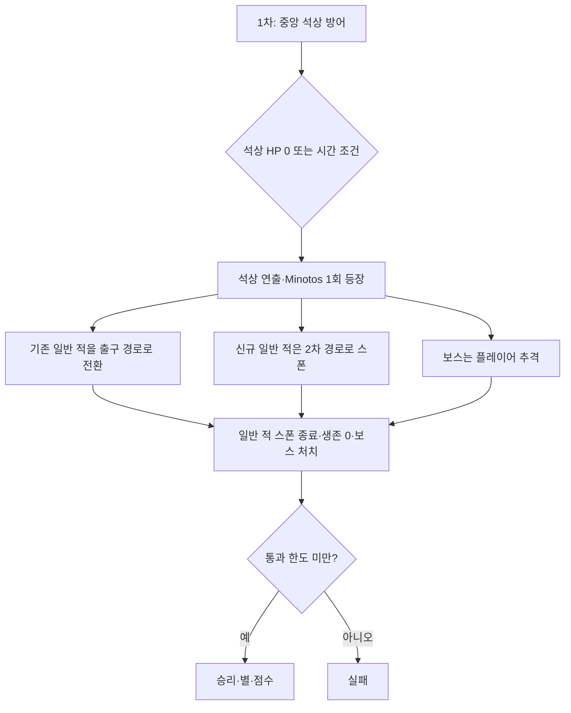

# 웨이브와 Stage 3의 2단계 전투

[README](../README.md) · [WaveController](../src/Wave/WaveController.cs) · [Stage3Controller](../src/Stage/Stage3Controller.cs)

## 데이터와 완료 조건

EnemySpawnData는 적 프리팹과 수량을, WaveData는 생성 그룹과 한 묶음의 수를 정의합니다. Stage1/2/3Data가 웨이브·시간·목표 설정과 배율을 제공합니다.

예정된 생성을 모두 마쳤다는 조건과 생존 일반 적 0을 함께 만족해야 웨이브를 완료합니다. 중복 완료를 막기 위해 이벤트 전에 진행 상태를 바꿉니다.

```cs
bool canComplete =
    _isWaveRunning &&
    !_hasWaveFailed &&
    !HasStoppedForStageResult &&
    _hasFinishedSpawning &&
    ActiveEnemyCount == 0;
```

## Stage 2 방향별 스폰

A/B, C/D, E/F, G/H를 한 쌍씩 묶어 네 방향으로 사용합니다. 쉬움·보통·어려움 모두 1~3웨이브 한 방향, 4웨이브 두 방향, 5웨이브 세 방향을 선택합니다.

웨이브 시작 때 방향을 중복 없이 무작위 선택하고 종료까지 유지합니다. 선택한 방향 모두에서 최소 한 마리씩 먼저 생성하고, 생성 묶음 안에서는 같은 스포너를 중복 선택하지 않습니다. 초반 묶음은 2마리로 맞추되 전체 적 구성·수량·난이도 배율은 유지했습니다.

[Stage2Data](../src/Stage/Stage2Data.cs)의 방향 목록을 비워 두면 기존 전체 방향 사용과 호환됩니다. 실제 난이도 ScriptableObject 에셋은 원본 프로젝트에 연결돼 있으며 이 발췌 저장소에는 포함하지 않았습니다.

## Stage 3 전환



준비 시간에 전환 타이머가 먼저 진행되지 않도록 전투 상태를 확인합니다. 시간 전환을 사용할 수 있는 지정 웨이브 조건도 둬 보스가 루프 후반에 등장하도록 조정할 수 있습니다. 목표 파괴는 별도 전환 조건입니다.

### 기존 적의 합류점 선택

[EnemyMovement.TrySwitchToExitPath](../src/Enemy/EnemyMovement.cs)는 지상 적의 현재 위치에서 접근 가능한 출구 웨이포인트까지의 실제 NavMesh 거리를 비교합니다. 직선으로만 가까운 벽 너머 점을 선택하지 않도록 했습니다.

목표를 공격하던 적은 공격을 취소하고 이동합니다. 기절·넉백 정지는 유지하고 상태 종료 후 재개합니다. 신규 일반 적은 각 스포너에 연결된 2차 경로를 사용합니다.

### 보스와 일반 적의 집계

보스는 일반 적 생존·통과 집계에서 제외하고 처치 상태를 따로 추적합니다. 일반 웨이브가 끝나도 보스가 살아 있으면 전투 제한시간은 계속 감소합니다.

| 결과 | 조건 |
| --- | --- |
| 승리 | 일반 웨이브 종료, 일반 적 생존 0, 보스 처치, 통과 한도 미만 |
| 실패 | 통과 한도 도달, 부활 소진, 전체 전투 제한시간 초과 |
| 3별 | 석상 무피해·통과 0으로 클리어 |
| 2별 | 석상 피해 발생·생존·통과 0으로 클리어 |
| 1별 | 석상 파괴 또는 적 통과가 있지만 패배 조건 전에 클리어 |

석상 HP 0은 즉시 패배가 아닌 2차 전환입니다. 전환 때 원래 HP·최대 HP·피해 이력을 저장해 이후 별·점수·미션에 사용합니다.

마지막 적과 플레이어가 함께 쓰러지는 경우에는 LateUpdate에서 생존 또는 부활 대기까지 확인하고 승리를 접수합니다.

## HUD 조회와 정산

TotalWaveCount는 실제 초기화한 난이도의 웨이브 수를 제공합니다. RemainingCombatTime은 Stage 3의 실제 시간 초과 판정과 같은 값을 제공합니다. 확정 점수는 StageScoreData로 계산하며, 보상 지급·저장은 공용 종료 계약을 사용합니다.
