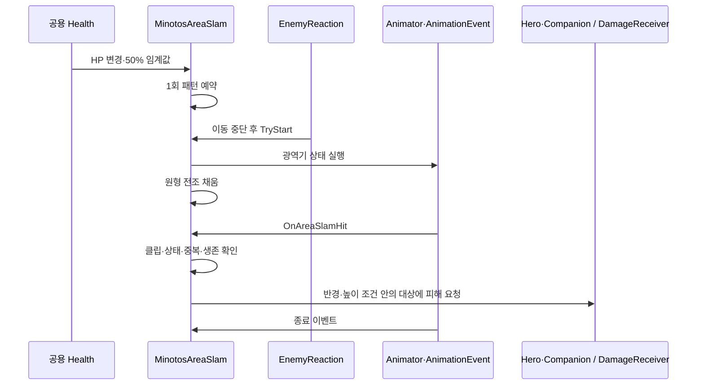

# 보스 광역기와 석상 등장 연출

[README](../README.md) · [MinotosAreaSlam](../src/Enemy/MinotosAreaSlam.cs) · [Stage3StatueReveal](../src/Stage/Stage3StatueReveal.cs)

## 기존 공격 모션을 이용한 광역기

보스의 체력이 50% 이하가 되면 내려찍기를 한 번 예약합니다. 실행 시작 여부를 따로 기록해 같은 조건에서 반복 실행하지 않습니다.

```cs
private void HandleHpChanged(float currentHp, float maxHp)
{
    if (!_hasStarted && currentHp > 0f && currentHp <= maxHp * 0.5f)
    {
        _isQueued = true;
    }
}
```

기존 공격 클립을 조정해 팔을 올리는 전조를 늘리고 내려찍는 동작으로 연결했습니다. 바닥 원은 실제 피해 반경에 맞추고, 애니메이션의 진행 시간과 타격 이벤트 시간을 기준으로 채웁니다.



대상은 플레이어와 동료입니다. 수평 반경과 높이 허용치를 확인하며, 피해 자체는 팀 공통 DamageReceiver에 요청합니다. 종료·사망·비활성화에서는 전조와 실행 상태를 정리합니다.

원형 채움 표현은 [MinotosAreaSlamTelegraph.shader](../src/Shaders/MinotosAreaSlamTelegraph.shader)에서 확인할 수 있습니다. 보스 모델·원본 애니메이션은 외부 에셋이므로 포함하지 않습니다.

## 석상 붕괴와 등장

석상 파괴와 시간 조건은 같은 연출·전환 경로를 사용합니다. 균열·빛줄기 예고 뒤 석상 메시·충돌을 해제하고 파편·먼지를 재생합니다. 보스는 중앙에서 한 번 등장하고 일반 적과 달리 플레이어를 계속 추격합니다.

파편은 착지 지점을 Raycast로 구해 시각적으로 이동시키며 플레이어·적을 막는 잔해 Collider로 남기지 않습니다. 균열 표현은 [Stage3StatueCracks.shader](../src/Shaders/Stage3StatueCracks.shader)를 사용합니다.

## 성능과 남은 과제

Profiler에서 이 전환 시 파편 착지 Raycast 58회·AddComponent 179회가 한 프레임에 나타났습니다. 연출 기능 구현과 별개로 파편·먼지 사전 생성·재사용은 아직 후속 과제입니다. [성능 분석](06-performance.md)에서 측정과 제안을 구분했습니다.
