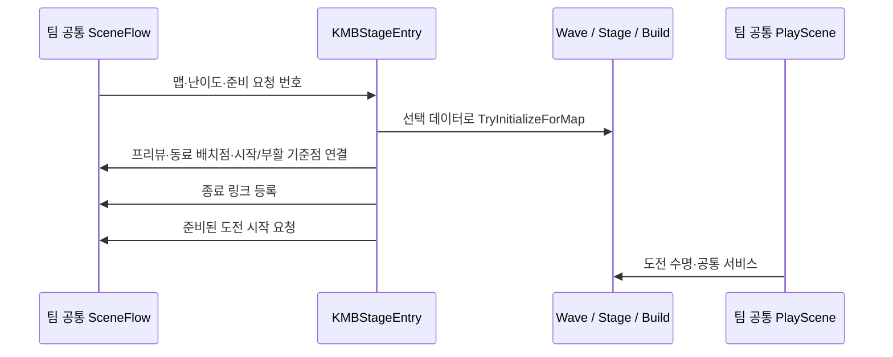

# PlayBase·저장·보상 연계

[README](../README.md) · [진입 모듈](../src/Stage/) · [의존성](DEPENDENCIES.md)

## 맵 준비

공용 PlayBase는 플레이어·입력·카메라·UI를 유지합니다. 맵 씬에는 지형·설치 영역·스포너·경로·웨이브·판정을 둡니다.

KMBStage1/2/3Entry를 통해 난이도 선택, 설치 프리뷰와 배치, 동료 배치점, 시작·부활 기준점과 종료 링크를 연결했습니다. 동료 배치점은 원본 맵에서 Stage 1·2·3 각각 3·4·9개를 구성했습니다. 씬 파일과 동료 AI 자체는 포함하지 않습니다.

준비 요청 번호는 현재 맵 로드 요청을, 도전 번호는 처치·저장·종료가 어느 플레이에 속하는지 식별합니다. 서로 대체해서 사용하지 않습니다.

## 적 사망과 도감·미션

적 사망은 원본 데이터·원래 도전·생명 식별 정보·피해 원인을 전달합니다. 플레이어·동료·설치물의 팀 처치를 공용 미션·보상으로 연결합니다. 도감과 미션의 저장·보상 기반은 팀 공통 구현입니다.

## 일반 웨이브 저장

[WaveController](../src/Wave/WaveController.cs)는 생성을 마치고 일반 적이 0이 되면 웨이브를 완료합니다. 마지막이 아닌 웨이브에서 저장 요청을 하고 실패한 완료 번호를 보류해 재시도할 수 있게 했습니다. 마지막 웨이브는 최종 종료·정산 흐름을 사용합니다.

보스가 살아 있는 동안 일반 웨이브가 끝나면 보스를 일반 적 수에서 제외하되 전투 상태와 제한시간은 유지합니다. 저장 호출 시 필요한 준비·전투 구간 전환과 복원을 연결했습니다.

## 최종 결과

| 책임 | 담당 |
| --- | --- |
| 승패·방어 이력·별·확정 점수 | KMB |
| 종료 조율·보상 계산·지급·저장 | LJ 공통 기능 |
| 결과·실패 안내·이동 버튼 | LHJ UI |

종료 접수 후 스폰·공격을 중단하고 마지막 처치·미션 전달이 끝난 뒤 CompleteEndEvents를 호출합니다. 종료 재시도는 최초 결과와 점수를 유지합니다. 화면 갱신 때문에 KMB 코드가 보상을 새로 지급하는 방식은 아닙니다.

## 미니맵·UI 자료 전달

맵의 탑뷰·비율·길이·스폰 위치 자료와 타깃 식별 연결을 제공했습니다. 미니맵 표시 UI 전체나 공통 카메라·플레이어 구현을 개인 구현으로 소개하지 않습니다.
