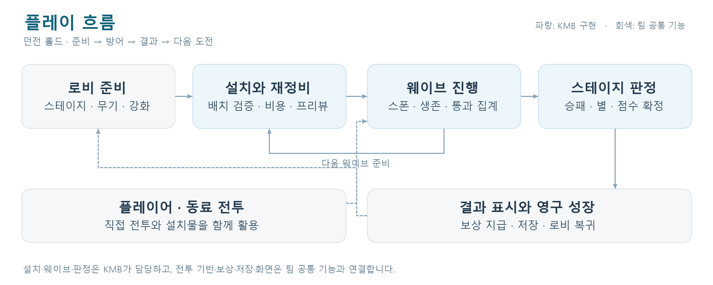
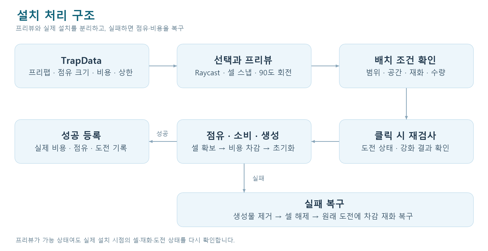
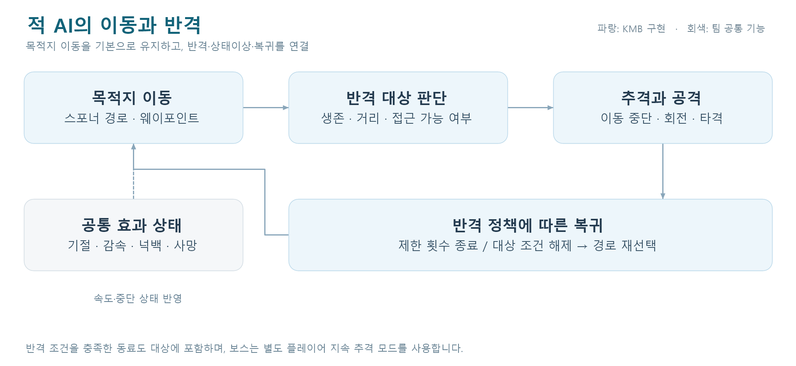
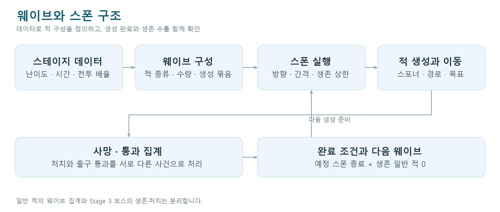
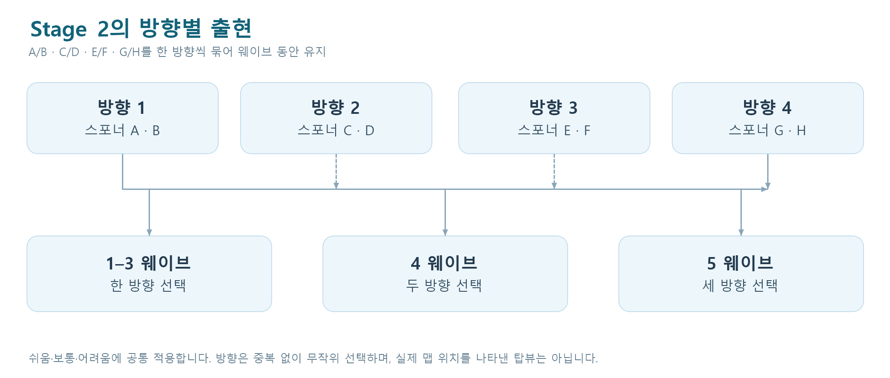
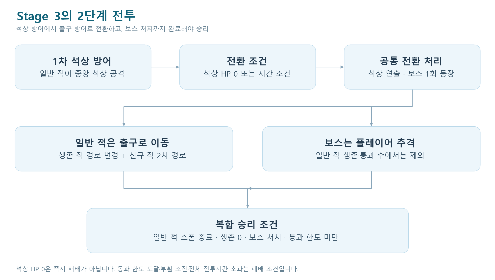
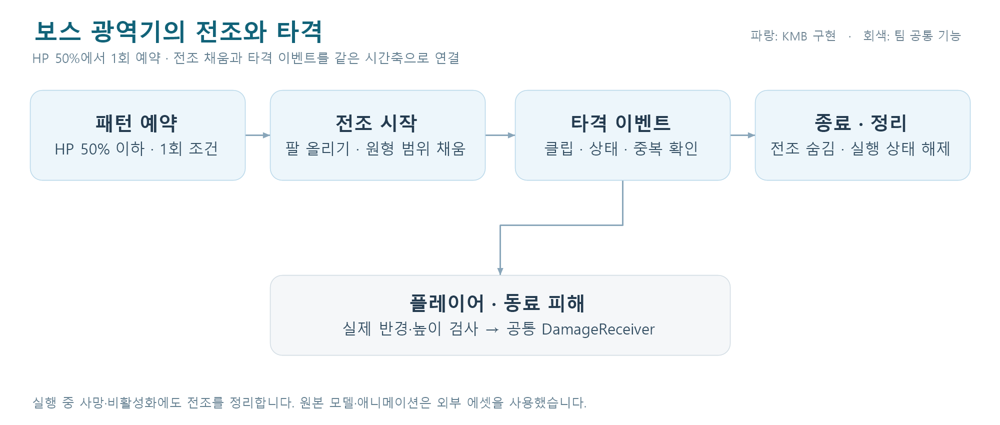
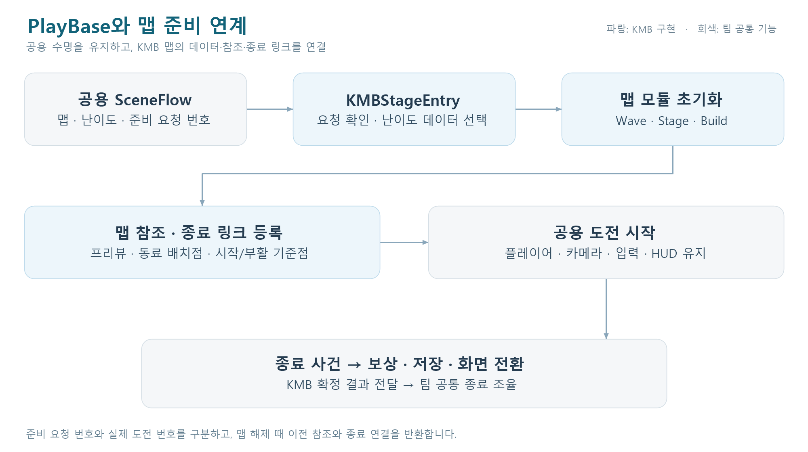

# 던전 홀드 구조도

노션 포트폴리오에 사용한 구조도입니다. PNG는 표시용, SVG는 수정 가능한 원본입니다.

파란색은 KMB 담당 구현, 회색은 연결해서 사용한 팀 공통 기능을 나타냅니다. Stage 2 방향 그림은 실제 맵 배치가 아닌 개념도입니다.

## 플레이 흐름

[SVG 원본](01-play-flow.svg)

## 설치 처리 구조

[SVG 원본](02-placement.svg)

## 적 AI의 이동과 반격

[SVG 원본](03-enemy-ai.svg)

## 웨이브와 스폰 구조

[SVG 원본](04-wave-spawn.svg)

## Stage 2의 방향별 출현

[SVG 원본](05-stage2-directions.svg)

## Stage 3의 2단계 전투

[SVG 원본](06-stage3-phases.svg)

## 보스 광역기의 전조와 타격

[SVG 원본](07-boss-slam.svg)

## PlayBase와 맵 준비 연계

[SVG 원본](08-map-integration.svg)

